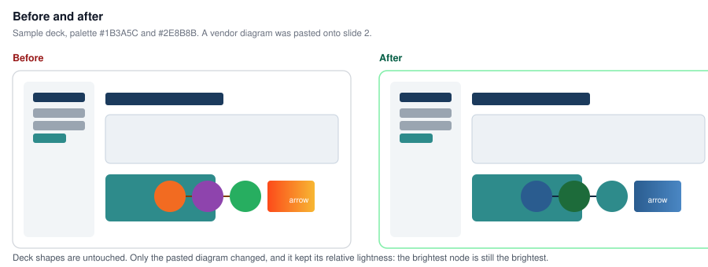
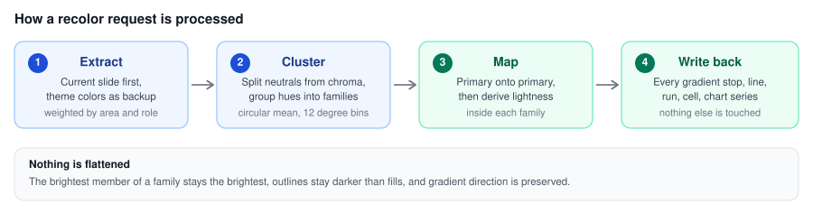
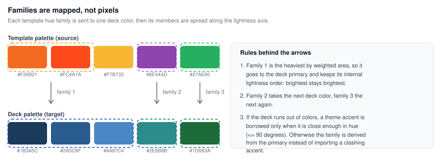
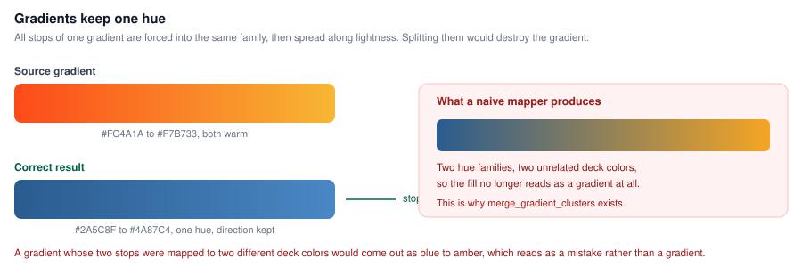
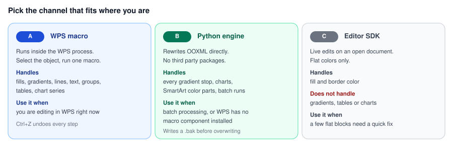

# wps-ppt-recolor

**Paste a template diagram into a slide, run one command, and its colors become your deck's colors.**

Every deck has its own palette. Every template library has a different one. So you paste in an
icon set, a relationship diagram, a flow chart or a chart, and it arrives wearing orange, purple
and green while your slides are deep blue and teal. Fixing that by hand means clicking through
dozens of shapes, gradients and outlines.

This tool reads the palette your deck actually uses — the current slide first, then the theme —
and rewrites the pasted object into that palette. It keeps the object's own lightness structure,
so the brightest node is still the brightest, outlines stay darker than fills, and gradients stay
gradients.



---

## Contents

- [How it works](#how-it-works)
- [Why it is not just "replace color"](#why-it-is-not-just-replace-color)
- [Quick start](#quick-start)
- [Choosing what to recolor](#choosing-what-to-recolor)
- [Options](#options)
- [Tuning](#tuning)
- [The sample deck](#the-sample-deck)
- [Coverage and limits](#coverage-and-limits)
- [Repository layout](#repository-layout)

---

## How it works



1. **Extract.** Every color on the current slide is collected from fills, gradient stops, lines,
   text runs and table cells, weighted by *area x role* (a fill counts more than a hairline,
   a huge block counts more than a caption). The theme's `clrScheme` accents are kept as backup.
2. **Cluster.** Colors are split into neutrals and chroma, then chroma is grouped into hue
   families using a circular mean, so 350 degrees and 10 degrees average to 0 rather than 180.
3. **Map.** Each template family is sent to one deck color. Within a family, members are spread
   along the lightness axis around the target color's own lightness.
4. **Write back.** Colors are rewritten in place. Position, size, text, animation and effects are
   never touched.

## Why it is not just "replace color"

### Families, not pixels



Mapping color-by-color would flatten everything into one shade. Instead, families are mapped to
families and lightness is re-derived inside each one, which is what keeps a diagram readable after
the swap.

There is one subtlety worth knowing. When the deck runs out of colors, a theme accent is borrowed
**only if it is close enough in hue** (90 degrees by default, `--harmony-max`). A deck that only
ever uses blue and teal should not suddenly gain an orange family just because orange happens to
be `accent2` in the theme file. If nothing is close enough, the extra family is derived from the
primary instead.

### Gradients keep a single hue



All stops of one gradient are forced into the same family before mapping. Without that step, a
warm gradient like `#FC4A1A -> #F7B733` splits into two families and comes back as blue to amber,
which reads as a mistake instead of a gradient.

A minimum lightness spread (`--gradient-spread`, default 0.16) is then enforced, because source
gradients are often so flat that a faithful mapping produces something that no longer looks like
a gradient at all.

## Quick start



### Channel A — inside WPS (recommended)

Runs in the WPS process, so changes appear immediately and `Ctrl+Z` undoes every step.

1. WPS Presentation → **Developer → Macro Editor** → Insert → Module.
2. Paste the whole of [`scripts/wps_macro.js`](scripts/wps_macro.js) into the code window.
3. Save.
4. Back on the slide, select the pasted object and run `recolorSelection`.

Four entry points are exposed:

| Function | What it does |
| --- | --- |
| `recolorSelection()` | Recolors the selection; if nothing is selected, the last inserted object |
| `recolorLastInserted()` | Always the last inserted object |
| `recolorWholeSlide()` | Everything on the current slide |
| `showSlidePalette()` | Reports the extracted palette and changes nothing |

**Run `showSlidePalette()` first.** It shows the primary, the color order and the neutral range.
Confirm the primary really is your slide's main color before changing anything — if the extraction
picked the wrong color, everything downstream is wrong too.

WPS versions differ in which JSAPI properties they expose, so the macro degrades instead of
failing: gradient stops fall back to a two-color gradient, theme colors fall back to scanning the
layout shapes, and anything unreachable is reported as skipped.
See [docs/wps-macro-setup.md](docs/wps-macro-setup.md).

### Channel B — the Python engine

No third-party packages. Standard library only, Python 3.7 or newer.

```bash
# Look at the report first. Nothing is written.
python3 scripts/recolor.py deck.pptx --slide 5 --target last --dry-run

# Then write
python3 scripts/recolor.py deck.pptx --slide 5 --target last
```

Overwriting in place creates `deck.pptx.recolor.bak` first. Use `--out` to write elsewhere.

| Scenario | Command |
| --- | --- |
| Pasted a grouped diagram | `python3 scripts/recolor.py deck.pptx --slide 5` |
| Pasted a chart | `python3 scripts/recolor.py deck.pptx --slide 5 --target last` |
| Slide has nothing else to sample | `python3 scripts/recolor.py deck.pptx --slide 5 --scope layout` |
| Two objects pasted together, only one should change | `python3 scripts/recolor.py deck.pptx --slide 5 --target name:flow --exclude name:legend` |
| Whole deck | loop over `--slide` with `--target all` |

## Choosing what to recolor

| `--target` | Selects |
| --- | --- |
| `last` | **Default.** The last inserted non-placeholder shape — normally what you just pasted |
| `all` | Every shape on the slide |
| `name:foo` | Shapes whose name contains `foo` (may match several) |
| `id:7` | Shape with that id |
| `idx:3` | The fourth top-level shape (zero based) |

`--exclude` takes the same syntax and removes shapes from *sampling*, not from recoloring. This
matters when several parts of a template were pasted at once: the parts you are not recoloring
would otherwise vote on what "the deck's palette" is.

## Options

| Flag | Meaning |
| --- | --- |
| `--slide N` | Slide number, 1 based |
| `--target ...` | What to recolor, see above |
| `--scope page\|layout\|deck` | Sampling range: current slide, plus layout, plus every slide |
| `--priority page\|theme` | Primary color source: most used on the slide, or theme `accent1` |
| `--exclude ...` | Shapes to ignore while sampling; repeatable |
| `--depth FLOAT` | Lightness derivation strength, default 0.85 |
| `--harmony-max DEG` | Max hue distance for borrowing a theme accent, default 90 |
| `--gradient-spread FLOAT` | Minimum lightness gap across a gradient, default 0.16 |
| `--out FILE` | Write to another file instead of overwriting |
| `--dry-run` | Report only |
| `--json` | Machine readable report |
| `--no-backup` | Skip the `.bak` file |
| `--no-keep-extremes` | Allow pure white and pure black to be remapped |
| `--include-scheme` | Also rewrite `a:schemeClr` theme references into fixed RGB |

## Tuning

| Symptom | Fix |
| --- | --- |
| Everything looks flat, nodes no longer distinguishable | Raise `--depth` to 1.1 |
| Light nodes blow out, dark nodes crush | Lower `--depth` to 0.6 |
| The gradient is invisible | Raise `--gradient-spread` to 0.24 |
| Wrong color became the primary | `--priority theme`, or `--exclude` the shapes that skewed it |
| Slide has nothing to sample from | `--scope layout` or `--scope deck` |
| An unrelated accent appeared | Lower `--harmony-max` to 45 |

The full derivation rules are in [docs/algorithm.md](docs/algorithm.md).

## The sample deck

[`examples/`](examples/) contains a synthetic three-slide quarterly review: deep blue and teal
palette, with a vendor diagram pasted onto slide 2 and a vendor chart onto slide 3. No real data
is involved anywhere.

```bash
cd examples
python3 make_sample.py            # needs python-pptx, only to build the sample
cp sample_before.pptx sample_after.pptx
python3 ../scripts/recolor.py sample_after.pptx --slide 2 --target last --out sample_after.pptx
python3 ../scripts/recolor.py sample_after.pptx --slide 3 --target last --out sample_after.pptx
```

On slide 2 the orange family becomes navy while keeping its internal lightness order, the green
node takes the deck's teal, and the outline stays the darkest element in the group.

## Coverage and limits

Rewritten: solid fills, every gradient stop, lines, text runs, highlights, effect colors, image
duotones, table cell fills, group children at any depth, chart series in `ppt/charts/*.xml`, and
SmartArt color parts in `ppt/diagrams/*.xml`.

Left alone by design:

- **`a:schemeClr` theme references.** These already follow the document theme, so rewriting them
  would be fixing what is not broken. Pass `--include-scheme` if you disagree.
- **Pure white and pure black.** White text on a dark block should not turn into light grey.
  Pass `--no-keep-extremes` to override.
- **Bitmap images.** A PNG icon cannot be recolored; only its border and transparency can.
- **Everything that is not a color.**

Known limits: SmartArt rendering varies between WPS versions, so eyeball it after a change. The
Python engine edits the file on disk, so if the same file is open in WPS, the application will not
pick up the change until it is reopened.

## Repository layout

```
scripts/
  recolor.py       Zero-dependency OOXML recolor engine
  wps_macro.js     WPS JSAPI macro that runs inside the application
docs/
  algorithm.md     Derivation rules and why each one exists
  wps-macro-setup.md  Installing and troubleshooting the macro
  images/          Diagrams used by this README
examples/
  make_sample.py   Builds the synthetic demo deck
  sample_before.pptx
  sample_after.pptx
```

## License

MIT. See [LICENSE](LICENSE).
